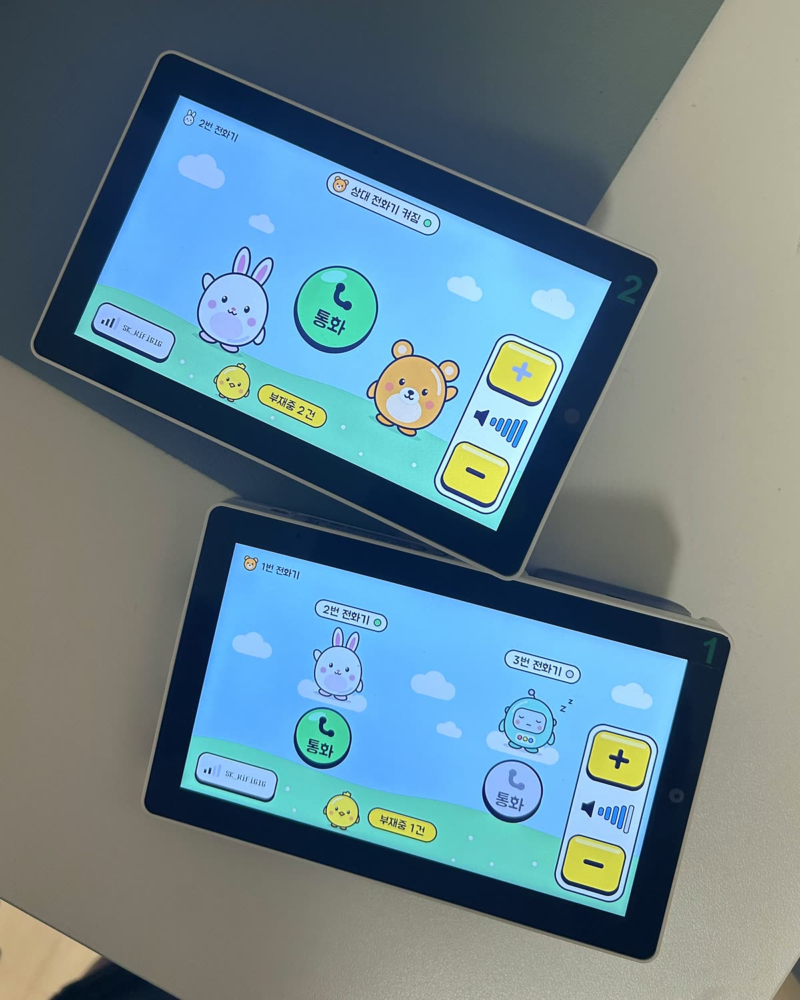

# tab5-toy-phone

**장난감처럼 생긴 진짜 전화기.** M5Stack **Tab5** 두 대(+ 스택짱 한 대)가 인터넷을 건너 서로 전화를 겁니다.
집에 한 대, 사무실에 한 대. 캐릭터를 누르면 상대 벨이 울리고, 받으면 스피커폰으로 통화합니다.

> A toy-styled walkie phone for the M5Stack Tab5 (ESP32-P4). Two or three devices call each other over the internet
> through a tiny Python WebSocket relay — echo cancellation + Opus, cute characters, Korean toy-phone UI.
> Firmware is ESP-IDF, the relay is one Python file, and everything (design docs → tests → firmware → relay) was built
> together with Claude Code. Docs are in Korean.



| 대기 화면 | 전화 옴 | 통화 중 |
|---|---|---|
|  |  |  |

## 무엇이 되나

- **걸기 / 받기 / 거절 / 끊기** — 곰(1번), 토끼(2번), 로봇(3번 스택짱). 대기 화면에 상대 캐릭터가 서 있고, 그 아래 통화 키캡을 누르면 걸립니다.
- **벨 끄기**, **메시지로 거절**("회의 중이에요" 등 문구 3개 → 건 쪽 화면에 10초 표시), **부재중 N건**.
- **목소리**: 마이크 → 에코 제거(ESP-SR AEC) → Opus 24kbps/20ms → 교환기 → 상대 스피커. 스피커폰으로 동시에 말하고 듣습니다. 지터 버퍼, 하울링 억제, 음량 5단계.
- **신호음**: 벨, 연결음, 종료음 (기기 안에서 합성).
- **Wi-Fi 설정 화면**: 화면 자판으로 망을 추가하면 기기에 저장됩니다.
- **교환기(relay)**: `server/phone_relay.py` 한 파일. 기기 2~8대 등록, 거는 상대 지정, 통화 여러 건 동시, 토큰 인증, `127.0.0.1` 바인딩 + Cloudflare 터널로 공개.
- **화면**: 1280×720 을 기기와 맥이 같은 코드로 그립니다(`raster.h`). 캐릭터와 아이콘은 SVG(`tools/toy_art.py`)로 그려 RLE 스프라이트로 구워 넣고, 글꼴은 주아체(OFL).

## 구조

```
기기 A ──wss://──┐
기기 B ──wss://──┤  Cloudflare 터널 ──> 교환기 phone_relay.py (127.0.0.1:5094)
스택짱 ──wss://──┘       신호(JSON 글자 프레임) + 음성(Opus 이진 프레임) 중계
```

```
firmware/tab5_phone/      Tab5 펌웨어 (ESP-IDF 5.5, ESP32-P4)
  main/                   call_fsm.h(상태 기계) relay_proto.h(신호 규약) voice*.{h,cpp}(목소리) ui*.cpp(화면) toy.cpp(테마) …
  tools/                  맥에서 도는 단위 시험(C++ 15종), 화면 미리보기(render_screens.py), 시리얼 조작(phone_ctl.py), 그림·글꼴 굽기
firmware/stackchan_phone/ 스택짱(CoreS3 기반 ESP32-S3) 전화기 펌웨어 — tab5_phone 의 순수 헤더를 그대로 끌어 씀, UIFlow2 와 이중 부팅
server/                   교환기 phone_relay.py + 순수 로직 phone_core.py, pytest 481개, 가짜 상대·스모크·토큰 도구, launchd/터널 배포 스크립트
docs/design/README.md     디자인 규칙 (§5 토이폰 테마)
docs/exec-plans/          설계서·실행 계획·결정 기록 (Phase 0 → 3대 통화까지, 한국어)
```

## 시작하기

아래 명령 블록은 모두 **저장소 맨 위 폴더에서 시작**합니다. 줄 끝에 설명을 달지 않았으니 그대로 붙여 넣어도 됩니다(macOS 기본 셸 zsh 는 붙여 넣은 줄의 `# 설명` 을 주석으로 보지 않습니다).

### 1. 준비 — 가상환경, 비밀 파일, 토큰

```bash
cd server
python3 -m venv .venv && .venv/bin/pip install -r requirements-phone.txt
cp /dev/null .env.phone && chmod 600 .env.phone
cd ../firmware/tab5_phone
cp main/secrets.h.example main/secrets.h
python3 ../../server/tools/phone_token_rotate.py --relay-url wss://phone.example.com/ws
```

- `firmware/tab5_phone/main/secrets.h` 에 Wi-Fi 와 기기 표(MAC·번호·ID)를 채웁니다. MAC 은 `python -m esptool -p <포트> read_mac`.
- 토큰 도구는 기기마다 토큰을 새로 만들어 `server/.env.phone` 과 `main/secrets.h` 에 **함께** 씁니다. `--relay-url` 에는 자기 교환기 주소를 넣습니다 — 같은 Wi-Fi 안에서만 시험할 때는 `ws://<교환기를 띄운 컴퓨터의 주소>:5094/ws`.
- 두 파일은 git 에 올라가지 않습니다(`.gitignore`). 토큰 없이 교환기를 띄우면 `설정 오류: PHONE_TOKENS` 로 끝납니다.

### 2. 교환기

```bash
cd server
BIND=0.0.0.0 PORT=5094 .venv/bin/python phone_relay.py
```

같은 Wi-Fi 안에서 시험할 때의 명령입니다(`BIND=0.0.0.0` 은 같은 망의 기기가 붙을 수 있게 엽니다).
인터넷을 건너려면 교환기를 `127.0.0.1` 에만 열고 Cloudflare 터널(또는 다른 TLS 역프록시)로 `wss://`를 줍니다.
launchd + 전용 터널로 세우는 스크립트와 설명은 [server/deploy/README.md](server/deploy/README.md).

### 3. 펌웨어 (Tab5)

```bash
cd firmware/tab5_phone
source ~/esp/esp-idf-5.5.4/export.sh
idf.py set-target esp32p4 && idf.py build
python -m esptool --chip esp32p4 -p /dev/cu.usbmodem* write_flash @build/flash_args
```

ESP-IDF 5.5 가 필요합니다(`export.sh` 의 경로는 설치한 곳에 맞춥니다). 처음 빌드는 부품을 내려받느라 몇 분 걸립니다.
기기 번호는 칩 MAC 으로 정해지므로 **두 대에 같은 바이너리**를 올립니다.
스택짱(3번)은 [firmware/stackchan_phone/README.md](firmware/stackchan_phone/README.md) — UIFlow2 를 지우지 않고 한 플래시에 함께 두는 설치법이 적혀 있습니다.

### 4. 맥에서 도는 시험

```bash
cd firmware/tab5_phone/tools
SDK="$(xcrun --sdk macosx --show-sdk-path)"
for t in wifi_store call_fsm relay_proto device_id roster ui_layout tones pcm jitter_buffer voice_core voice_tune tx_dyn vol_steps relay_diag howl_loop raster; do
  clang++ -std=c++17 -isysroot "$SDK" -I../main -o /tmp/t_$t test_$t.cpp || { echo "$t: 컴파일 실패"; continue; }
  /tmp/t_$t > /tmp/t_$t.log; echo "$t: 종료값 $? · $(tail -1 /tmp/t_$t.log)"
done
cd ../../../server && .venv/bin/python -m pytest -q
```

C++ 시험 16종은 줄마다 `종료값 0 · … 0 failed` 가 나와야 합니다(종료값이 0 이 아니면 실패 — 중간에 죽은 경우 포함). 교환기 시험은 481개.
macOS 기준이며, `-isysroot` 를 빼면 링크가 안 되는 환경이 있습니다.

도구 시험과 화면 미리보기는 파이썬 꾸러미가 더 필요합니다(ESP-IDF 를 export 하지 않은 셸에서).

```bash
server/.venv/bin/pip install pillow pyserial
cd firmware/tab5_phone/tools
../../../server/.venv/bin/python -m pytest -q test_phone_ctl.py test_relay_tls_shape.py
../../../server/.venv/bin/python render_screens.py
```

도구 시험은 263개. `render_screens.py` 는 기기와 같은 그리기 코드로 화면 PNG 를 `firmware/tab5_phone/out/screens/` 에 만듭니다.
스택짱의 이중 부팅 시험까지 돌리려면 `littlefs-python` 도 설치합니다.

## 보안 메모

- **빌드 결과물을 공유하지 마세요.** `build/*.bin` 과 `out/` 꾸러미에는 `secrets.h` 의 내용 — 등록한 **모든 기기의 토큰**과 Wi-Fi 비밀번호 — 이 그대로 들어 있습니다. 플래시 암호화는 켜지 않았으므로, 기기를 잃어버렸다면 `phone_token_rotate.py` 로 토큰을 전부 바꾸세요.
- **`secrets.h`, `server/.env.phone` 은 git 에 올리지 않습니다**(`.gitignore`). 포크해서 쓸 때도 그대로 두세요.
- **인터넷을 건널 때는 `wss://` 만.** `ws://` 는 같은 Wi-Fi 안의 개발용이며 토큰과 목소리가 암호화되지 않습니다. 교환기는 `127.0.0.1` 에만 열고 TLS 는 터널·역프록시가 맡습니다.
- 기기에 시계가 없어 TLS 인증서의 **유효 기간은 검사하지 않습니다**(서명 사슬과 호스트 이름은 검사). 이유와 되돌리는 법은 `firmware/tab5_phone/main/relay_link.cpp` 의 P4N-D1.
- USB 시리얼 콘솔에는 인증이 없습니다(터치 주입·재시작 등). 화면에서 넣은 Wi-Fi 비밀번호는 기기 안(NVS)에 평문으로 저장됩니다 — 기기를 손에 쥔 사람은 읽을 수 있다고 보세요.

## 하드웨어

- [M5Stack Tab5](https://docs.m5stack.com/en/core/Tab5) × 2 — ESP32-P4, 5인치 1280×720 터치, ES8388 스피커 + ES7210 마이크(에코 기준 채널 포함), C6 Wi-Fi(esp_hosted 2.11)
- (선택) M5Stack StackChan(CoreS3, ESP32-S3) — 3번 전화기. 320×240, 내부 RAM 이 빠듯해 에코 제거와 Opus 를 다른 코어에 둡니다.

## 만든 방식

설계서(목표·비목표·영향 범위·결정 기록) → 맥 단위 시험 → 펌웨어 → 교환기 → 기기 검증 순서로, 모든 단계를 **Claude Code** 와 짝으로 진행했습니다.
그 기록이 `docs/exec-plans/` 에 그대로 있습니다(결정마다 이유·비용·탈출구). 개인 기기 MAC·호스트명·경로는 공개하면서 자리표시자로 바꿨습니다.

## 라이선스

- 코드·문서·캐릭터: [MIT](LICENSE)
- 글꼴 주아체(Jua): [SIL OFL 1.1](firmware/tab5_phone/tools/fonts/OFL.txt)
- ESP-IDF 부품(esp_hosted, esp-sr, opus 등): 각 부품의 라이선스
