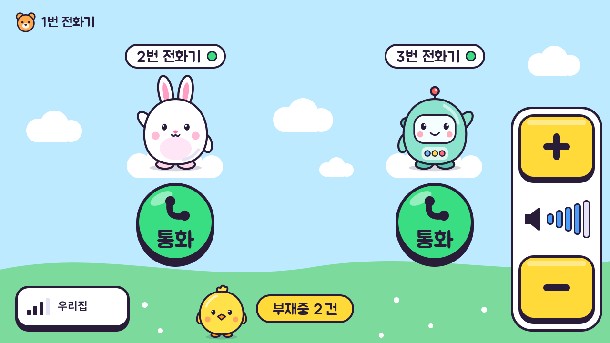
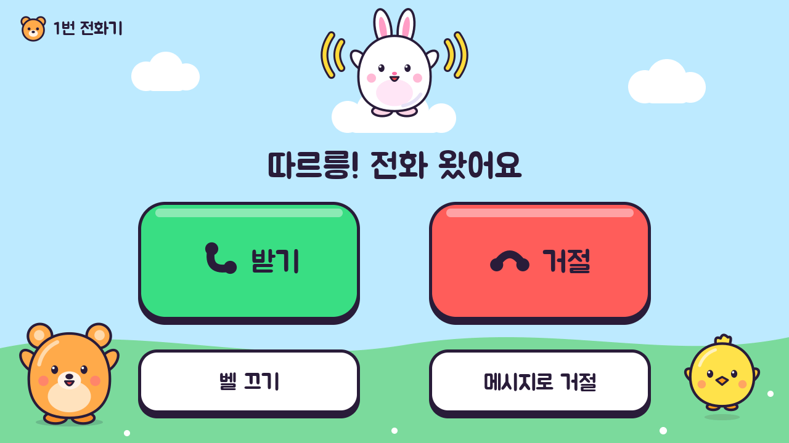
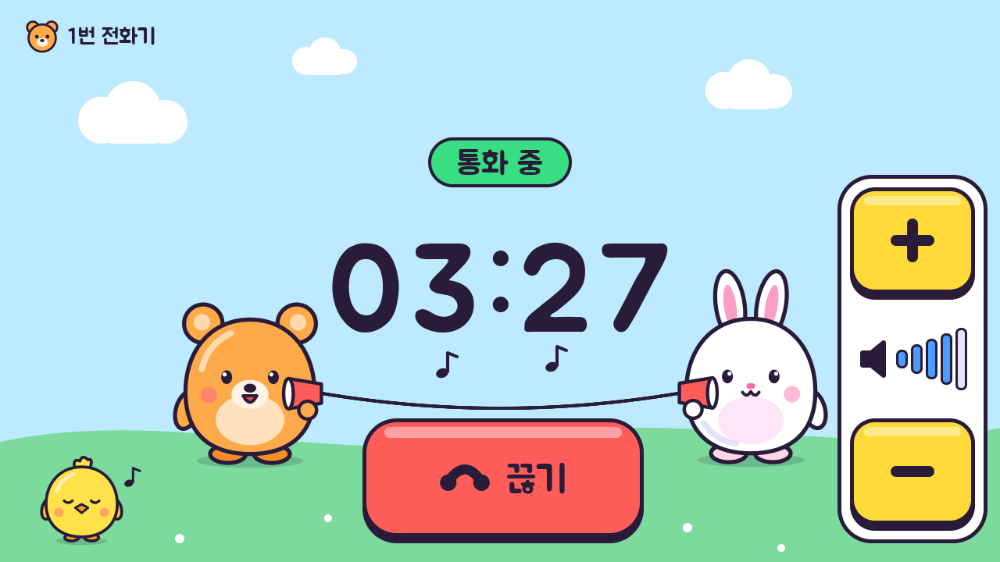

# 공통 디자인 규칙 (m5tab5)

기준 문서. 모든 UI(Tab5 화면·서버가 내는 웹 페이지)는 이 규칙을 먼저 확인하고 따른다. 새 유형은 여기 먼저 정의한 뒤 구현한다.

## 0. 원칙
- **한 벌의 디자인 언어**: 공개 페이지 example.com/tab5(`web/public/tab5/styles.css`)의 웜 모노크롬 + 스팟 파스텔을 전 산출물이 공유한다.
  - **예외 하나 — Tab5 전화기 화면은 §5 토이폰 테마를 쓴다**(2026-10-08 사용자 결정: "장난감 전화기 + 귀여운 캐릭터들"). §1 의 색·서체와 아래 "장식 금지"는 전화기 화면에 적용하지 않고, 대신 §5 의 규칙이 그 자리를 채운다. 스냅부스·웹 페이지는 그대로다.
- **품질 게이트**: 결과물은 100점 루브릭(exec-plan §9) **95점 이상**까지 수정↔검수 반복. 검수는 생성자와 분리(code-reviewer·design-review).
- **최소 요소, 정확한 여백**: 장식보다 위계·간격·타이포로 완성도를 낸다. AI slop 패턴(과한 그라데이션·이모지 남발·정체불명 아이콘) 금지.

## 1. 디자인 토큰 (웹·Tab5 공통)
| 토큰 | 라이트 | 다크 | 용도 |
|---|---|---|---|
| bg | #FBFBFA | #161615 | 배경 |
| surface | #FFFFFF | #1D1D1B | 카드·패널 |
| line | #EAEAEA | #2A2A28 | 구분선·테두리 |
| ink | #111111 | #F2F1EE | 제목·강조 |
| ink-2 | #2F3437 | #D9D8D4 | 본문 |
| muted | #787774 | #9A9893 | 보조 |
| pale-blue / -t | #E1F3FE / #1F6C9F | #1C2E3A / #8FCBF2 | 업무·정보 |
| pale-yellow / -t | #FBF3DB / #956400 | #3A3220 / #E8C877 | 재미·주의 |
| pale-green / -t | #EDF3EC / #346538 | #1F2E22 / #A6D6AA | 완료·놀이 |
| pale-red / -t | #FDEBEC / #9F2F2D | #3A2223 / #F0A7A5 | 강조·매출 |
| accent-shutter | #E36A63 | #E36A63 | Tab5 촬영 버튼(반투명 링·원, 알파 175/200) |

서체: 본문 Pretendard Variable, 제목 Newsreader(세리프), 코드/라벨 JetBrains Mono. 라운드 12px(카드) / 9999px(칩). 이징 `cubic-bezier(0.16,1,0.3,1)`.

## 2. Tab5 화면 규칙 (1280×720 가로, 정전식 터치, 손님이 만짐)
- **풀블리드**: 카메라 프리뷰·결과 이미지는 화면 전체(1280×720)를 채운다. 레터박스 금지 → 소스 해상도를 16:9로 맞춘다(왜곡·크롭 금지).
- **터치 타깃 ≥ 96×96px**, 주요 액션(촬영)은 ≥ 160px, 화면 하단 중앙. 촬영 버튼은 accent-shutter 반투명(프리뷰가 비침) 링+원, 가장자리 2단 알파. 손가락 가림을 고려해 상태 텍스트는 상단.
- **스타일 선택**: 대기 화면 상단 중앙에 스타일 칩(높이 56, 선택=ink 채움, 최대 2행 자동 랩·초과분 생략). 칩은 터치 타깃 96px 규칙의 **예외**(밀도 우선, 히트 영역은 칩보다 각 변 상하 5px·좌우 6px 확장(행 간격 10px 안에서 겹침 없음)). 스타일 목록·프롬프트는 서버 `snapbooth_styles.json`(핫리로드, 영문 템플릿 + 스타일/장면 분리).
- **상태는 4가지만**: 대기(프리뷰+스타일 칩+촬영 버튼) → 촬영/처리중(진행 표시, 예상 시간) → 결과(이미지 풀블리드 + QR 오버레이 + 다시 찍기) → 오류(한 문장 + 재시도). 각 상태 진입 시 무엇을 해야 하는지 한 줄로 안내.
- **오버레이 가독성**: 이미지 위 텍스트·QR은 surface 80~90% 반투명 패널 위에. QR 최소 240×240px, 조용한 영역 확보.
  구현: 화면에 직접 덧그리지 않고 **소스 프레임 버퍼(1280×720)에 먼저 합성**한 뒤 PPA 로 한 번에 출력한다(원자적 갱신 = 깜빡임 없음, 진짜 알파 블렌딩 가능). 텍스트는 `tools/gen_ui_assets.py` 가 Pretendard 로 구운 알파 마스크를 블렌딩(내장 비트맵 폰트 확대 금지). 도형은 안티앨리어싱(`fillSmoothCircle/RoundRect`).
- **타이포**: 안내 문구 ≥ 28px, 버튼 라벨 ≥ 32px, 카운트다운 숫자 ≥ 240px. 모두 사전 렌더 알파 마스크(Pretendard Bold/ExtraBold). 동적 짧은 문자열(IP)만 내장 폰트 허용. 다크 톤 기본(카메라·행사장 조명에 유리).
- **모션**: 200~300ms. 구현: PROCESSING 딤·패널, RESULT QR 패널을 250ms 알파 이즈인(40ms 간격 재렌더). 처리중은 확정적 진행(초 카운트)으로 불안 제거.
- **오류 문구**: 원인 + 다음 행동 한 문장(예: "서버에 닿지 않아요. 잠시 후 다시 눌러 주세요").

## 3. 서버 웹 페이지 규칙 (공유 `/share`, 결과)
- 모바일 우선(QR로 폰에서 열림). 16px 사이드 거터, 가로 스크롤 금지, 라이트/다크 모두 대응(`prefers-color-scheme` + `data-theme`).
- 구조: 결과 이미지(카드) → 저장 버튼(주 액션, 풀폭) → 작은 푸터(행사명·비노출 문구). 로고·행사명은 설정값.
- 접근성: 대비 4.5:1 이상, 버튼 텍스트 명시, 이미지 alt.

## 4. 검수 체크리스트 (design-review 전 자가 점검)
- [ ] 토큰 외 색상 하드코딩 없음 · [ ] 여백 8px 그리드 · [ ] 위계(제목/본문/보조) 3단 이내
- [ ] 터치 타깃 규격 · [ ] 풀블리드 유지 · [ ] 4상태 전이 누락 없음 · [ ] 오류 문구 규칙 · [ ] 다크/라이트 검증
- 전화기 화면(§5)은 위 대신 §5.9 의 점검표를 쓴다.

## 5. 토이폰 테마 — Tab5 전화기 화면 (2026-10-08~)

**범위**: `firmware/tab5_phone` 의 모든 화면(통화 화면 + Wi-Fi 설정 화면). **한 줄 요약**: 하늘과 동산 위에 캐릭터가 서 있는 장난감 전화기 — 누르는 것은 키캡, 캐릭터가 상태를 보여 준다.
**전화기 3대(2026-10-08 밤~)**: 전화기는 셋이다(1번·2번 = Tab5, 3번 = 스택짱). 대기 화면에 상대 **둘**이 서고, 걸고 싶은 상대의 통화 키캡을 누른다(설계 `docs/exec-plans/2026-10-08-phone-3way-design.md` §9). 스택짱의 작은 화면(320×240)은 같은 색·키캡·캐릭터를 쓰되 배치가 따로다(`firmware/stackchan_phone`, 그 설계서 TW-D18).
시안(캔버스): https://claude.ai/artifact/XdBkmmmCxTaKcpdAui2ZGn · 실제 그리기 코드로 만든 화면 모음: [img/phone-toy/all-screens.png](img/phone-toy/all-screens.png) (다시 만들기: `firmware/tab5_phone/tools/render_screens.py`)

| 대기 (1번 기기 — 상대는 2번 토끼·3번 로봇) | 전화 옴 | 통화 중 |
|---|---|---|
|  |  |  |

(그림 파일 이름은 처음 만든 때의 것이다 — 화면 미리보기의 지금 장면 이름과는 다르다: `10_idle` = `10_idle_u1_on_on`, `11_idle_peer_off` = `11_idle_u1_on_off`, `30_incoming` = `41_incoming_from_rabbit`, `41_in_call` = `51_in_call_with_rabbit`, `50_wifi_list` = `60_wifi_list`.)

### 5.1 색 (정본: `firmware/tab5_phone/main/toy.h`)
| 이름 | 값 | 쓰임 |
|---|---|---|
| SKY | #BFE8FF | 바탕(하늘) |
| HILL | #7ED99A | 동산 |
| CLOUD · WHITE | #FFFFFF | 구름 · 보통 버튼의 윗면, 판 |
| INK | #2A1F3D | 모든 테두리와 글자(검정 대신 짙은 자주빛 남색) |
| GO | #3DDC84 | 통화·받기·켜짐·연결 |
| STOP | #FF5C5C | 끊기·거절·오류 |
| WARN | #FFD93D | 알림·부재중·음량 버튼·켜진 대문자 글쇠 |
| VOL | #4D9FFF | 음량 막대·입력 커서 |
| PALE | #E6E1F2 | 꺼진 것·빈 막대·보조 글쇠·못 누르는 자리 |
| MUTED · FAINT | #625977 · #B4ADC6 | 흐린 글자 · 더 못 가는 기호 |
| GO_SOFT | #C9F5DD | 목록에서 지금 연결된 줄 |

- 글자는 어느 바탕에서나 INK 다(색 위에 흰 글자를 쓰지 않는다 — 명도 대비가 가장 낮은 STOP 위에서도 5.1:1). 흐린 글자는 MUTED 까지만, 그리고 SKY·WHITE·PALE·GO_SOFT 위에서만 쓴다(넷 다 4.5:1 이상. 동산·초록·빨강 위에서는 3.3:1 이하라 쓰지 않는다).
- 받기/거절은 색(초록/빨강) + 수화기 그림(든 모양/엎은 모양) + 글자 + 자리(왼쪽/오른쪽) 네 가지로 구분한다(색만으로 구분하지 않는다).

### 5.2 글자
- 고정 문구·숫자는 **주아체(Jua, SIL OFL 1.1)** 를 맥에서 알파 마스크로 굽는다(`tools/gen_ui_assets.py` → `main/ui_assets.h`). 굵기는 하나뿐이다.
- 크기: 통화 시간 160 · 화면의 큰 문구 56 · 주요 버튼 48(둥근 통화 키캡의 "통화" 포함) · 보조 버튼·안내 36~40 · 상태 32(대기 화면의 이름 알약 "N번 전화기" 포함 — 켜짐 불빛이 함께 있는 상태 표시다) · 기기 이름 28(왼쪽 위의 내 이름표) (§2 의 "안내 28 이상, 버튼 32 이상" 유지).
- 주아체에는 말줄임표(…)·줄표(—)·가운뎃점(·)이 없다 → 문구에는 `...` 과 `-` 를 쓴다. 한글도 2,367자뿐이라 없는 글자를 쓰면 굽는 도구가 오류로 멈춘다.
- 말투는 "~요"로 맞춘다("따르릉! 전화 왔어요", "상대 전화기 켜짐/꺼짐"). 상대 기기는 "상대 전화기"라고 부른다.
- 바뀌는 글자(Wi-Fi 이름·자판 글쇠·쪽 번호)만 내장 글꼴(efontKR 16px 비트맵)이다 — 주아체가 아니고, 키워서 쓰므로 계단이 보인다(알려진 한계, 통화 설계서 Phase 5). 대기 화면의 Wi-Fi 이름과 목록의 쪽 번호는 1.5배(24px)라 위 "28 이상"의 예외다. 화면 미리보기는 이 글자만 맥의 다른 글꼴로 얹으므로 이 글자의 모양은 기기 스크린샷으로 판단한다.

### 5.3 누르는 것과 보여 주는 것
- **누르는 것 = 키캡**: INK 테두리 5px + 아래로 INK 그림자 8px + 색 윗면. **그림자가 있으면 눌린다.**
  - 키캡은 **그림자까지 터치 영역(Rect) 안에** 그린다(윗면이 Rect 보다 8px 낮다). 그래서 버튼 좌표(`main/ui_layout.h`)와 그 시험은 테마와 무관하다.
  - 글자·아이콘은 윗면의 가운데(`toy::keycap_cy`)에 놓는다. 모서리는 높이의 28%(18~44px). 색이 있는 큰 키캡(높이 150 이상)과 음량 버튼에는 윗면 위쪽에 반투명 흰 광택 줄.
  - 통화 버튼만 둥근 키캡이다(터치 원 안에 윗면 원 + 12px 그림자). 대기 화면에 **상대마다 하나씩**, 지름 176(반지름 88) — 그 상대 캐릭터의 바로 아래에 둔다.
- **보여 주는 것 = 납작한 알약·판**: INK 테두리 4~5px, 그림자 없음(상대 상태, "통화 중", 안내, 부재중, 음량 칸의 판, 비밀번호 칸).
- **못 누르는 자리**: 그림자·테두리 없는 PALE 판 + MUTED 글자("벨 꺼짐", 첫 쪽의 "이전").
- 예외 둘(눌리지만 흐리게 보이는 키캡): **그 상대가** 꺼져 있을 때의 통화 키캡(PALE 윗면 — 누르면 "꺼져 있어 걸 수 없어요" 안내가 뜬다)과 끝 단계의 음량 키캡(기호만 FAINT — 눌러도 그대로다). 둘 다 그림자를 남겨 자리가 흔들리지 않게 했다.
- 터치 대상 크기는 §2 그대로(96px 이상, 주요 버튼 160px 이상).

### 5.4 캐릭터 (그림 정본: `firmware/tab5_phone/tools/toy_art.py` — 직접 그린 것, 남의 캐릭터를 본뜨지 않는다)
| 캐릭터 | 맡은 일 | 자세 |
|---|---|---|
| 곰 | 1번 전화기 | wave(한 손 들기) · hi(wave 를 0.7배로 — 대기 화면의 상대) · sleep(눈 감고 Z — hi 와 같은 0.7배, 대기 화면에서만 쓴다) · cup(종이컵 전화) · cheer(두 손 들기) · caller(cheer + 좌우 울림 줄) |
| 토끼 | 2번 전화기 | 위와 같다 |
| 로봇 | 3번 전화기(스택짱) | 위와 같다. 곰과 같은 둥근 몸·굵은 테두리에 안테나(빨간 공)·네모난 얼굴 창·배의 단추 셋으로 "기계 친구"임을 보인다. 잠들면 안테나 공이 꺼지고(회색) 창이 어두워진다 |
| 병아리 | 알림 담당 | idle · big · jump · hum(눈 감고 음표) |

- 번호 ↔ 캐릭터는 한 곳(`main/toy.cpp` 의 `who_of_unit`)에서 정한다. 화면은 "지금 이 자리의 기기가 몇 번인가"(`ui_layout.h` 의 `peer_unit`·`call_unit`)만 보고 그린다 → 세 번호 어느 자리에서도 같은 코드가 돈다.
- **내 캐릭터는 왼쪽, 상대는 오른쪽**(오른쪽은 좌우를 뒤집어 그린다 — 바깥쪽 손을 들고, 컵이 가운데를 향한다. 잠든 그림만 뒤집지 않는다: Z 가 뒤집힌다). 거는 중·연결 중·통화 중의 "상대"는 **그 통화의 상대**다.
  - **예외 — 대기 화면**: 내 캐릭터는 서지 않는다. 왼쪽 위 이름표(작은 얼굴 + "N번 전화기")로만 남고, 그 자리에 **상대 둘**이 나란히 선다 — 왼쪽 = 번호가 작은 쪽. 오른쪽 상대만 뒤집어 둘 다 바깥쪽 손을 든다.
  - **상대는 구름 위, 나는 동산 위**: 대기 화면의 두 상대와 전화 옴 화면의 건 쪽은 구름에 올라서 있다(멀리 있는 친구). 전화가 이어지면(거는 중·통화 중) 동산으로 내려와 나와 마주 선다.
- **캐릭터가 상태를 보여 준다**: 상대 켜짐 = 손 흔들기 / 상대 꺼짐 = 잠듦 / 전화 옴 = **건 쪽**이 가운데 위 구름에서 울림 줄과 함께 / 통화 중 = 둘이 종이컵 전화를 줄로 잇는다.
- **켜짐·꺼짐은 세 가지로 함께 보인다**(색만으로 구분하지 않는다): 캐릭터(손 흔들기 ↔ 눈 감고 Z) + 이름 알약의 불빛(GO ↔ PALE) + 통화 키캡(GO 윗면·광택 ↔ PALE 윗면·흐린 그림과 글자).
- **누구에게 거는지는 그림으로 안다**: 통화 키캡은 그 상대 캐릭터의 바로 아래, 같은 세로줄에 있다(이름 알약 · 캐릭터 · 키캡이 한 줄). 두 줄은 화면 가운데를 비우고 멀리 떨어뜨려 잘못 누르지 않게 한다.
- 병아리는 알릴 것이 있을 때만 나온다: 부재중 팻말 옆, 연결 중(구름 위), 전화 옴(펄쩍), 통화 중(구석에서 흥얼).
- 캐릭터는 어떤 화면에서도 버튼·음량 칸·시계·문구와 **겹치지 않는다**. 자리는 `main/ui.cpp` 맨 위의 상수(대기 화면의 상대 줄은 `main/ui_layout.h` 의 칸)이고, 고친 뒤에는 화면 미리보기로 확인한다.
- 캐릭터는 누르는 것이 아니다(그림자는 발밑의 옅은 타원뿐 — 키캡 그림자와 다르다).

### 5.5 화면별 구성
| 화면 | 바탕 | 구성 |
|---|---|---|
| 연결 중(BOOT) | 하늘·동산·구름 | 구름 위 병아리 + 지금 하는 일 알약(보통 흰색, 기다리면 풀리는 문제 노랑, 손이 필요한 문제 빨강) + Wi-Fi 키캡 |
| 대기 | 〃 (구름 자리는 따로) | 왼쪽 위: 내 얼굴+번호 / **상대 둘이 나란히**(왼쪽 = 번호가 작은 쪽) — 각 줄은 위에서부터 이름 알약("N번 전화기" + 켜짐 불빛) · 구름 위의 캐릭터(켜짐 = hi, 꺼짐 = sleep) · 둥근 통화 키캡(그 상대가 꺼져 있으면 PALE) / 아래: Wi-Fi 키캡, 병아리+부재중 알약 / 오른쪽: 음량 칸 |
| 거는 중 | 〃 | "거는 중..." + (벨이 울리면) 알약 / 왼쪽 컵 든 나, 오른쪽 **건 상대** / 취소 키캡 |
| 전화 옴 | + 가운데 위 큰 구름 | 구름 위의 **건 쪽**(누가 걸었는지 = 그 캐릭터) / "따르릉! 전화 왔어요" / 받기(초록)·거절(빨강) / 벨 끄기·메시지로 거절 / 왼쪽 아래 나, 오른쪽 아래 병아리 |
| 메시지 고르기 | 하늘·동산 | 안내 문구 / 문구 키캡 셋 / 가운데 구름 위의 건 쪽(벨은 아직 울린다) / 뒤로 |
| 통화 중 | 하늘·동산·구름 | "통화 중" 알약 / 큰 통화 시간 / 컵 든 둘(왼쪽 나, 오른쪽 통화 상대)과 줄, 음표 / 끊기(빨강) / 음량 칸 / 구석의 병아리 |
| 연결 중·끊는 중 | 〃 | 컵 든 둘과 줄 + 문구 |
| Wi-Fi 설정 | 하늘 한 색 | 빽빽한 화면이라 동산·구름·캐릭터를 두지 않는다. 목록 줄·버튼·글쇠 = 키캡, 비밀번호 칸 = 판, 진행·결과 = 알약 |

- **대기 화면의 자리**(정본 `main/ui_layout.h` — `BTN_CALL`·`BTN_CALL_B`·`PEER_NAME`·`PEER_BODY`·`PEER_FEET_Y`): 두 줄의 가운데는 x 368·912(화면 가운데에서 좌우 272), 이름 알약 y 92~144, 캐릭터 칸 y 148~380(발밑 y 352, 그 밑의 구름 y 306~374), 통화 키캡 y 384~560. 시험이 "칸끼리·칸과 버튼이 겹치지 않는다"를, 화면 미리보기가 "그림이 칸을 넘지 않는다"를 본다.
  - 통화 키캡이 그 띠(y 232~567)에 있는 까닭: 화면이 손가락 밑에서 바뀌어도 다른 화면의 버튼이 눌리지 않아야 한다(`ui_layout.h` UL-D1·UL-D4 — 취소·끊기·벨 끄기·메시지 키캡과 겹치지 않는다). 그래서 캐릭터는 그 위 하늘(구름 위)에 0.7배로 서고, 아래 띠(Wi-Fi 키캡·부재중 알약)는 지금 자리 그대로다.
  - **받기·거절과는 겹친다**(둘까지 피할 자리가 없다): 왼쪽 통화 키캡 ↔ 받기, 오른쪽 ↔ 거절. 그래서 벨 화면이 대기로 바뀐 직후 1.5초 동안은 통화 키캡을 받지 않는다(`ui_layout.h` UL-D7 — 받으려던 손가락이, 또는 거절을 두 번 누른 손가락이 엉뚱한 상대에게 걸지 않게. 내가 거절한 뒤 "끊는 중"을 거쳐 온 대기 화면도 같다). 반대 방향(통화 키캡을 누르려는 순간 전화가 옴)은 지금까지의 0.6초 가드 그대로다. 새 버튼을 놓을 때는 "화면이 바뀌면 같은 자리가 무엇이 되는가"의 표(`tools/test_ui_layout.cpp` 의 swap 시험)를 함께 고친다.
- **안내**(잠깐 뜨는 알약)는 어느 화면에서나 **맨 윗줄 가운데**(`ui_layout.h` 의 `NOTICE_BAND` — y 14~78, 높이 64, 글자 36px)다. 전화 옴·메시지 고르기 화면에서는 그리지 않는다(그 자리에 건 쪽 캐릭터·안내 문구가 있다 — `ui_layout.h` UL-D3). 2026-10-08 밤에 한 줄 올리고 높이를 8 줄였다(예전 y 92~164, 높이 72): 대기 화면의 이름 알약 줄이 그 자리에 온다(`ui_layout.h` UL-D6).

| 안내 | 문구 | 바탕 | 띄우는 시간 |
|---|---|---|---|
| `PEER_OFF` | 상대 전화기가 꺼져 있어 걸 수 없어요 | WHITE | 4초 |
| `BUSY` | 통화 중이에요 (건 상대가 다른 통화·벨 중 — 전화기 3대부터) | WHITE | 4초 |
| `NO_ANSWER` | 받지 않았어요 | WHITE | 4초 |
| `REJECTED` | 상대가 받지 않고 끊었어요 | WHITE | 4초 |
| `REJECT_MSG` | 상대: (거절 문구 1~3) | WHITE | 10초 |
| `LOST` | 연결이 끊어졌습니다 | WHITE | 4초 |
| `CALL_ENDED` | 통화 종료 | WHITE | 4초 |
| `MISSED` | 부재중 전화가 있어요 | WARN | 4초 |
| `RELAY_SILENT` | 교환기 응답이 없어 다시 연결합니다 | WHITE | 4초 |

- 안내에는 "누구"를 넣지 않는다(상대가 둘이어도 방금 누른 키캡·방금 끝난 통화의 이야기다). 부재중 알약에도 누가 걸었는지는 넣지 않는다(설계서 §9 — 필요해지면 그때).

### 5.6 음량 칸
흰 판 안에 위에서부터 크게(＋) 키캡 · **스피커 그림 + 가운데 정렬 막대 5개** · 작게(−) 키캡. 지금 단계까지 VOL, 나머지 PALE.
- 막대는 반드시 스피커 옆에, 세로 가운데 정렬로 둔다. 바닥에 맞춘 계단 막대만 두면 Wi-Fi 신호 표시로 읽힌다(2026-10-08 사용자 지적).
- 끝 단계에서는 더 못 가는 쪽 기호를 FAINT 로 흐리게 한다.

### 5.7 그림 자산
- 캐릭터·아이콘: `tools/toy_art.py`(SVG 조각) → `tools/gen_toy_sprites.py`(rsvg-convert 로 그려 줄 단위 RLE 로 묶음) → `main/ui_sprites.h`. 장수·크기는 굽는 도구가 끝에 찍는다(전화기 3대부터: 캐릭터 셋 × 자세 여섯 + 작은 얼굴 여섯 + 병아리 넷 + 아이콘).
- 글자: `tools/gen_ui_assets.py` → `main/ui_assets.h`.
- 둘 다 구운 헤더를 git 에 둔다(빌드에는 도구가 필요 없다). 그림·문구를 바꾸면 다시 굽고 화면 미리보기로 확인한 뒤 올린다.

### 5.8 움직임
지금은 정지 그림이다 — 상태가 바뀔 때만 자세가 바뀐다. 화면 한 장을 내보내는 데 60~80ms 가 들고 통화 중에는 소리 처리가 우선이라, 움직임을 넣는다면 2~3컷·초당 2~3장 이하·통화 중에는 시계가 바뀌는 1초 박자에만 싣는다(다음 과제 — 넣기 전에 통화 품질 수치로 영향을 잰다).

### 5.9 점검표 (전화기 화면)
- [ ] 색은 `toy.h` 의 이름만 쓴다(값을 직접 적지 않는다) · [ ] 글자는 INK/MUTED 뿐
- [ ] 누르는 것은 전부 키캡, 키캡이 아닌 것은 눌리지 않는다 · [ ] 키캡이 터치 영역 밖으로 나가지 않는다
- [ ] 캐릭터가 버튼·음량 칸·시계·문구와 겹치지 않는다(내 번호 1·2·3 모두, 상대 둘의 켜짐·꺼짐 네 조합 모두)
- [ ] 대기 화면: 왼쪽 = 번호가 작은 상대 · 켜짐/꺼짐이 캐릭터·불빛·키캡 셋으로 함께 보인다 · 통화 키캡이 그 상대의 바로 아래에 있다(그림만 보고 누구에게 거는지 안다)
- [ ] 전화 옴·거는 중·통화 중의 상대 캐릭터가 그 통화의 상대다(건 쪽이 곰·토끼·로봇인 경우를 각각 봤다)
- [ ] 새 버튼·옮긴 버튼이 다른 화면의 버튼 자리와 겹치는지 표(`test_ui_layout.cpp` swap 시험)로 확인했다 — 겹치면 뜻이 같은 버튼이거나 시간 가드가 있어야 한다
- [ ] 화면 미리보기(`tools/render_screens.py`)의 모든 장면을 눈으로 봤다(이 도구는 음량 칸만 다시 그려도 화면이 달라지지 않는지도 검사한다) · [ ] 기기 스크린샷(`phone_ctl.py shot`)으로 한 번 더 봤다

### 5.10 스택짱 화면 (320×240, 2인치 — 3번 전화기)
같은 토이폰 테마를 작은 화면에 옮긴 것이다. 색·글꼴·캐릭터·"누르는 것은 키캡" 규칙은 §5.1~5.4 그대로이고, 아래만 다르다. 배치 정본 `firmware/stackchan_phone/main/sc_ui_layout.h`, 그리기 `sc_ui.cpp`, 미리보기 `firmware/stackchan_phone/tools/render_sc_screens.py`(→ `out/screens/sheet.png`).

| 항목 | 값 | 이유 |
|---|---|---|
| 테두리 · 그림자 · 알약 테두리 | 3 · 5 · 2 px (Tab5 는 5 · 8 · 4) | 화소 간격이 0.1275mm 로 Tab5(0.085mm)의 1.5배 — 같은 굵기로 보이게 |
| 누르는 것의 크기 | 주요 버튼(통화·받기·거절·끊기·취소) 가로·세로 **72px(9.2mm) 이상** / 보조 버튼(음량·스트림덱) 짧은 변 **56px(7.1mm) 이상** | 72px 을 전부에 요구하면 대기 화면에 상대 둘 + 스트림덱이 들어가지 않는다 |
| 글자 | 화면의 한 줄 28px · 키캡 26px · 안내·이름표 20~22px · 통화 시간 52px | 2.5mm 아래로 내려가지 않게 |
| 캐릭터 | 통화 키캡 안 = 얼굴(높이 60px, 흰 동그라미 안) / 거는 중·전화 옴·통화 중 = 전신(높이 104px — 종이컵·울림 줄 자세) / 이름표 = 얼굴 30px | Tab5 와 같은 그림 원본(`toy_art.py`)을 작게 굽는다(`tools/gen_sc_assets.py`) |
| 바탕 | 하늘 + 화면 아래의 낮은 동산 + 구름 둘 | 구름은 "조각만 다시 그리는 자리"(시계·음량 표시) 밖에만 둔다 |

**화면별 구성**

| 화면 | 구성 |
|---|---|
| 연결 중 | 이름표 · 병아리 · 지금 하는 일 한 줄 · "스트림덱" 키캡 |
| 대기 | 이름표(안내가 있으면 그 자리에 노란 안내 알약) · **통화 키캡 둘**(왼쪽 = 번호가 작은 상대. 켜짐 = 초록 + 깬 얼굴, 꺼짐 = 옅은 색 + 잠든 얼굴 + 흐린 글자) · "스트림덱" 키캡 · 부재중 알약 |
| 거는 중 | 종이컵을 든 상대 · "거는 중..." → "벨이 울리고 있어요" · 취소(빨강) |
| 전화 옴 | 울림 줄이 붙은 **건 쪽** 캐릭터 · "전화 왔어요!" · 받기(초록, 왼쪽) · 거절(빨강, 오른쪽) |
| 통화 중 | 상대(왼쪽) · 통화 시간(오른쪽) · 음량 표시 다섯 칸 · 작게 · 끊기(빨강) · 크게 |
| 스트림덱으로 가는 중 | 손 흔드는 내 캐릭터 · 한 줄 |

**규칙**
- 켜짐/꺼짐은 색만으로 가르지 않는다: 키캡 색 + 얼굴(깬/잠든) + 글자 색.
- 받기·거절은 색 + 수화기 그림(든 것/엎은 것) + 글자 + 자리(왼쪽 = 받기 — Tab5 와 같은 쪽)로 가른다.
- "스트림덱" 키캡은 **두 번 눌러야** 간다(첫 번째에 노란 "한 번 더!" 로 3초). 스트림덱이 없으면 그림자 없는 흐린 판(눌리지 않음).
- 벨 화면이 대기 화면으로 바뀐 직후 1.5초는 터치를 받지 않는다(받기·거절 자리와 통화 키캡의 아랫부분이 겹친다 — Tab5 와 같은 값).
- 통화 중에는 바뀐 조각만 다시 그린다(시계 1초마다, 음량은 누를 때). 조각 그리기 결과가 통째 그리기와 픽셀까지 같아야 한다 — 미리보기 도구가 견준다.
- 없는 것: 메시지로 거절 · 벨 끄기 · Wi-Fi 설정 화면(설계 TW-D5).

**점검표 (스택짱 화면)**
- [ ] `tools/test_sc_ui_layout.cpp` 통과(크기·겹침·화면 안·화면마다 그 화면의 버튼만) · [ ] `render_sc_screens.py` 의 모든 장면을 눈으로 봤다
- [ ] 내 번호가 1·2·3 어느 것이어도 그려진다(상대 표가 바뀌어도) · [ ] 기기 스크린샷(`sc_ctl.py … shot`)으로 한 번 더 봤다
